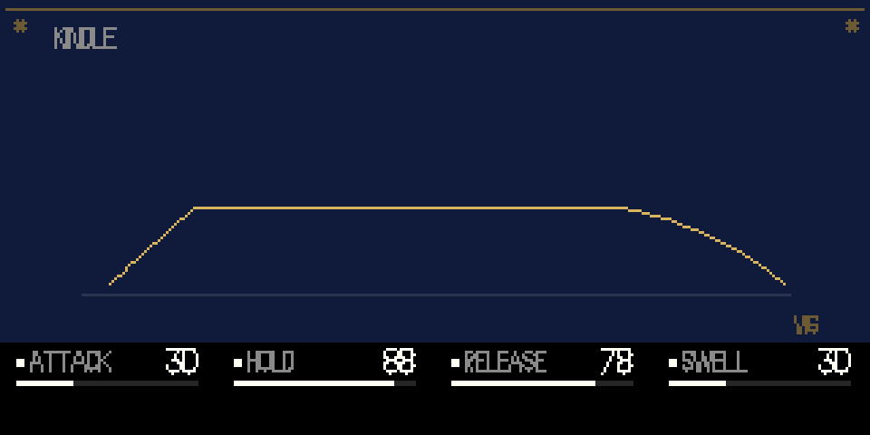
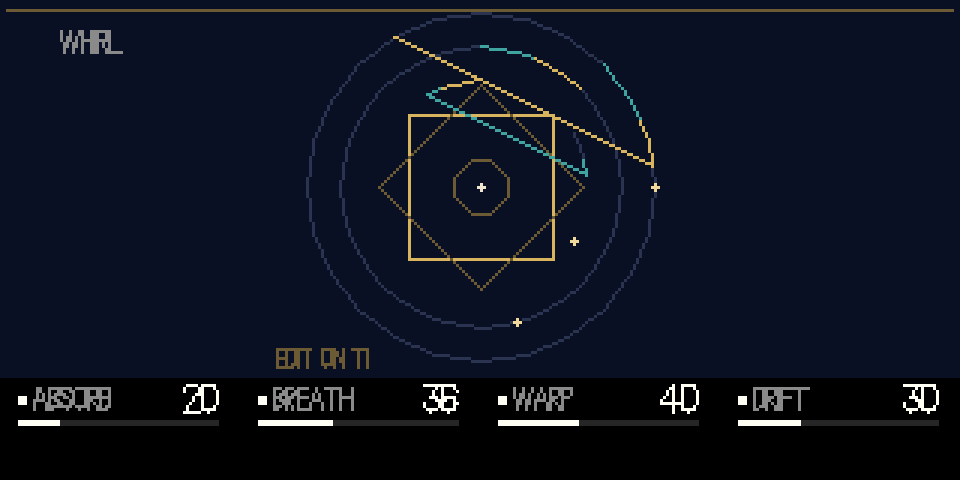

# sama

**An instrument of light and repetition — a drone synth for the original OP-1.**

One oscillator into one shared delay. The delay's filter, its loss and its feedback age the
sound; the note's own sub-harmonic warps the delay time; the loop moves the pitch and the
level of the source. Six voices sing into one room, and the room answers.

Built for [Opus 2](https://github.com/LizardMan245/opus) on the original OP-1 (firmware #246,
Blackfin BF524). Real-time, integer-only DSP. No samples, no libs, no floating point.


| | |
|---|---|
|  |  |
|  |  |

*(These are not mockups: the pictures are rendered from the plugin's own drawing code by
`test/render.c` + `test/render.py`, at the OP-1's true 320×160.)*

---

## What it is

Strega by Make Noise is a semi-modular drone instrument: an oscillator dripped into a
lo-fi delay, the delay's filter and loss inside the feedback loop, an agitation generator
breathing on the cutoff, and every path able to modulate every other. **sama** takes that
architecture and inverts its temperament — where Strega is a witch working alchemy, sama is a
niche holding a lamp. It is not affiliated with or endorsed by Make Noise; it is a homage.

What that means in the DSP:

- **One oscillator, one delay.** Every voice shares the same delay line — polyphony is a
  choir in one room, not six rooms.
- **The loop is the instrument.** Filter, absorb, feedback, drive and the loop's own highpass
  all sit *inside* the regeneration path. The tail is not an effect added afterwards; it is
  where the sound lives.
- **The sub-harmonic is a modulator, not a voice.** It bends the delay time (warp) and the
  oscillator's pitch, the way patching the sub-oscillator to Tonic does on the hardware.
- **The loop feeds back into the source.** Its level can duck or lift the oscillator (cross),
  and its envelope sags the pitch (drift) and colours the filter.
- **The envelope is the engine's own**, so a note you let go keeps sounding for as long as
  `hold` says — the drone is played, not triggered.

## Controls

T1 holds **four faces**. The four encoders always edit the face that is showing, and each face
keeps its own four values. **T3** turns to the next face; **T2** and **T4** jump to the kindle
and whirl pages (edit them from T1).

| knob | niche | space | kindle | cross |
|---|---|---|---|---|
| blue | tones: triangle → saw → sine-folded | absorb: the loop's lowpass, 18 kHz → 300 Hz | attack | cross: how far the loop moves the source |
| green | time: 20 ms – 1.2 s | breath: 0.02 – 40 Hz | hold: 0 – 27 s | polar: below 50 ducks, above 50 lifts |
| white | decay: the tail's feedback | warp: sub-harmonic → delay time | release | drive: the loop's saturation, 1 – 2× |
| orange | filter: 60 Hz – 9 kHz in the loop | drift: loop envelope → pitch | swell: breath → level | tone: the loop's highpass, 80 Hz – 1.2 kHz |

Pages: **T2** is the kindle page, **T4** the whirl. Both are views — the encoders work on T1
only, which is a firmware rule for plugin engines, so the pages select the face and the four
knobs do the editing.

## Install

1. Download `sama.opmod` from the latest [Actions run](../../actions) (or build it, below).
2. Back up the OP-1. Disk mode: `shift + COM`, then `T3`.
3. Copy `sama.opmod` into `mods/` — **not** `mods/bridge`.
4. Eject, restart.
5. `shift + T1` → engine list → **sama**.
6. The mods list (`menu`, then `T2`) shows it loaded, and its row's orange push shows the
   audio CPU figure.

Requires Opus 2 core **2.8** or newer. If it is refused, the row names the reason.

## Build

The plugin is compiled with `bfin-elf-gcc` (GNU binutils 2.38 + GCC 13.3.0, C only, no libc)
against the Opus 2 plugin kit. CI does all of this in
[`.github/workflows/build.yml`](.github/workflows/build.yml) and uploads the `.opmod`.

Locally:

```sh
git clone --depth 1 https://github.com/LizardMan245/opus /opt/opus
cd /opt/opus/plugin-kit
bash tools/toolchain/build-bfin-toolchain.sh fetch verify extract linux

export PATH=$HOME/bfin-build/linux-install/bin:$PATH
export OP1_BFIN_TOOLCHAIN=$HOME/bfin-build/linux-install
python3 /opt/opus/plugin-kit/plugin_tool.py build /path/to/this/repo
python3 /opt/opus/plugin-kit/plugin_tool.py show /opt/opus/plugin-kit/build/sama.opmod
```

The toolchain is a Linux ELF binary; on macOS run it inside a Linux container.

## Testing

`test/host.c` compiles the **real** `sama.c` against stub API calls and renders audio on the
host, so the DSP can be swept and measured without the device:

```sh
cd test
cc -O2 -I/opt/opus/plugin-kit/sdk -o host host.c -lm
./host /tmp/out.wav 55 61 88 54 20 36 40 30 30 88 78 30 35 30 10 40
```

The sixteen arguments are the four faces in k99: niche, space, kindle, cross.

`test/render.c` runs the plugin's page functions on the host and dumps a display list;
`test/render.py` draws it with the OP-1's own vector font — that is how the art above is
generated.

Measured on the host (each control swept 0→99, rms at 1 s / 2 s / 5 s):

| control | 0 | 99 |
|---|---|---|
| tones | 8,312 | 3,321 |
| time | 13,953 | 2,718 |
| decay (5 s tail) | 7,868 | 11,191 |
| filter | 1,975 | 9,496 |
| absorb | 5,709 | 2,494 |
| breath | 2,304 | 8,599 |
| warp | 5,810 | 5,440 |
| drift | 7,450 | 5,739 |
| attack | 830 | 10,081 |
| hold (5 s) | 29 | 11,031 |
| swell | 6,548 | 4,067 |
| cross | 5,905 | 5,172 |
| polar | 5,267 | 6,363 |
| drive | 5,249 | 12,993 |
| tone | 5,755 | 2,355 |

CPU: claimed `cycles 200000` in `cpu.txt` (a conservative ceiling); the device reports the real
worst block in the mods list, and `cpu.txt` should be updated from it.

## Repo layout

```
sama.c            the engine: voices, the delay loop, the pages
sama_art.h        page point tables (generated by tools/gen_art.py)
sama_tab.h        DSP tables: delay lengths, filter, absorb, tone, breath (tools/gen_tab.py)
manifest.txt      the plugin manifest (id jake.sama, core 2.8)
cpu.txt           the declared CPU ceiling
tools/            table and art generators
test/host.c       host render + audio harness
test/render.c     host page renderer -> display list
test/render.py    display list -> PNG (OP-1 font)
art/              the screenshots in this README
```

## Credits

- [Opus 2](https://github.com/LizardMan245/opus) and its plugin kit — the platform this runs on.
- Mutable Instruments' open-source DSP, which informed the filter, the folder and the
  saturation approach.
- Make Noise's Strega, designed by Tony Rolando and Alessandro Cortini, for the architecture
  and the vocabulary of this instrument.

## License

MIT — see [LICENSE](LICENSE).
