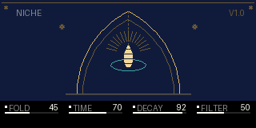
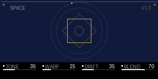
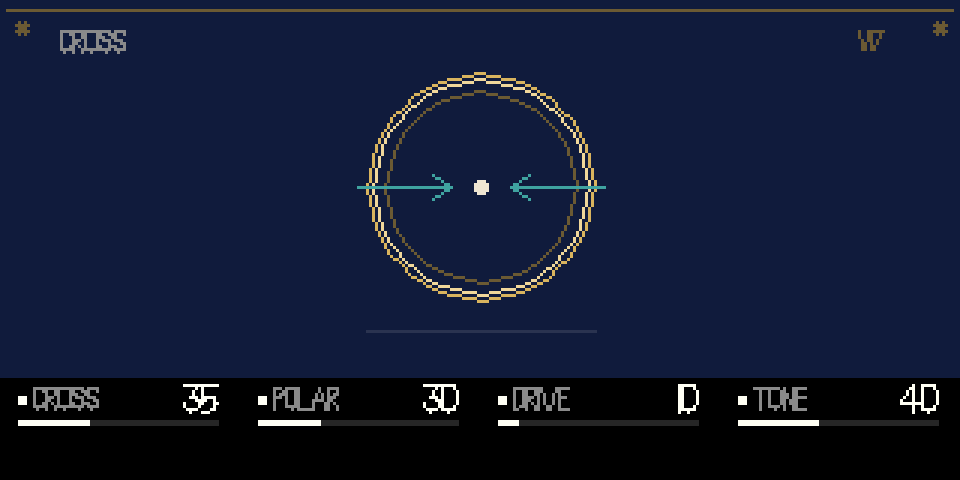
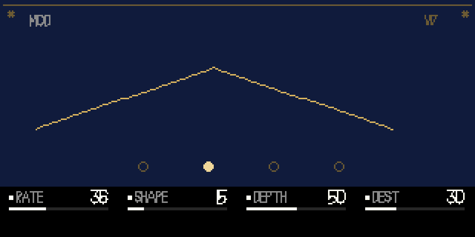
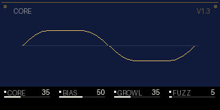
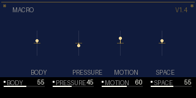

# sama

[](https://github.com/doo-nothing/sama/actions/workflows/build.yml)

**An instrument of light and repetition — a drone synth for the original OP-1.**

One oscillator into one shared, tunable room. The room's filter, loss and feedback age the
sound; the note's sub-harmonic warps the delay time; the loop moves the pitch and the level of
the source; and the room's own audio bends the source's phase. Six voices sing into one room,
and the room answers.

Built for [Opus 2](https://github.com/LizardMan245/opus) on the original OP-1 (firmware #246,
Blackfin BF524). Real-time, integer-only DSP. No samples, no libs, no floating point.

| | |
|---|---|
|  |  |
|  |  |
|  |  |

*(Not mockups: these are rendered from the plugin's own drawing code by `test/render.c` and
`test/render.py`, at the OP-1's true 320×160.)*

---

## What it is

Strega by Make Noise is a semi-modular drone instrument: an oscillator dripped into a lo-fi
delay, the delay's filter and loss inside the feedback loop, an agitation generator breathing
on the cutoff, and every path able to modulate every other. **sama** takes that architecture
and inverts its temperament — where Strega is a witch working alchemy, sama is a niche holding
a lamp. It is not affiliated with or endorsed by Make Noise; it is a homage.

- **One oscillator, one room.** Every voice shares the delay line — polyphony is a choir in one
  room, not six rooms.
- **The loop is the instrument.** Filter, tone, drive, resonance and the loop's own highpass all
  sit *inside* the regeneration path. Drive lowers the saturation knee instead of adding gain.
- **The room has a body.** With `tune` on, the time knob selects 1–16 periods of the lowest note
  and the loop runs clean: the delay becomes a tuned comb, and high decay makes it sing at the
  note instead of squealing at a random resonance.
- **The loop feeds back into the source.** Its level ducks or lifts the oscillator (`cross`), its
  envelope sags or lifts the pitch (`drift`), it colours the filter, and its audio bends the
  oscillator's phase at audio rate (one block of latency).
- **It is playable.** A note-on strike gives the room a transient, the filter tracks the root,
  `shift + T1` freezes the room into a drone, `FN + T1` loads the next scene, and the macro face gives
  four performance gestures over the twenty deep controls.

## The instrument, simply

Think of sama as **one lamp in one room**.

- The **lamp** is the oscillator. Each key lights its own lamp (one of six voices), but every
  lamp shines into the *same* room.
- The **room** is a delay that feeds back into itself. Its filter, tone, saturation and decay
  do not just echo — they colour and age the sound, and the room slowly forgets.
- **The room can touch the lamp.** Its audio can bend the lamp's pitch at audio rate
  (`cross`), and its loudness can duck or lift the lamp and bend its pitch (`drift`). The room
  is not an effect after the synth; it is part of the synth.
- The **lamp's character** is the `core` face: triangle/sine/saw/pulse, the folder, bias,
  growl and fuzz.
- The **performance** is the `macro` face: four big gestures that move many of the deeper
  controls at once.

The signal path is one line:

```
keys → six voices → oscillator + folder → strike → cross gate → sum
     → the room (delay, diffusion, filter, tone, drive, decay)
     → blend with the dry voices → out
```

The room's output is also what comes back to the voices: it phase-modulates the oscillator,
and its envelope moves the source's level and pitch.

## The controls, simply

There are **twenty deep controls and four macros** but only four knobs. A **face** is simply
what the four knobs mean right now. The knobs are the OP-1's own T1 knobs, so the system LFO
(T4) can still wobble them.

**The page map**

- **T1** is the page key; plain T1 does nothing (it is already selected).
- **T3** pages to the previous face; **T4** is the system's LFO page; **T2** is the system's
  envelope.
- The four **encoder pushes** jump straight to niche / space / cross / core.
- **FN + T1** loads the next scene; **shift + T1** freezes the room (the keys are muted while
  it is held; press again to release).

**The seven faces, in plain words**

| face | what it is for | the four knobs |
|---|---|---|
| **niche** | the instrument | fold (how folded), time (how long the room), decay (how long it rings), filter (how dark/bright the room is) |
| **space** | how the room ages | tone (dark/bright tilt), warp (the note's sub wobbles the echo), drift (the room's loudness bends the pitch), blend (dry vs room) |
| **cross** | the room against the lamp | cross (how much the room pushes the lamp), polar (duck/lift and feedback sign), drive (room saturation), res (filter resonance) |
| **mod** | the automatic mover | rate, shape, depth, dest (filter / time / pitch / cross) |
| **core** | the lamp itself | core (triangle → sine → saw → pulse), bias (asymmetry), growl (sub → phase FM), fuzz (saturation) |
| **macro** | the performance layer | body (filter/decay/tone/res), pressure (fold/drive/fuzz), motion (LFO/drift/warp/wow), space (blend/diffusion/cross) |

The **macro** face is for playing; the deep faces are for editing. The macros are offsets,
neutral at 50: they do not overwrite the deep values, they lean on them.

**The settings** (blue push on sama's row in the mods list) are the room's character:
**scale** (the slow pitch mod's scale), **tune** (the room becomes a resonator tuned to the
lowest note), **wow** (tape wobble), **keytrack** (the room filter follows the note),
**diffuse** (the allpass smear).

## Pages and faces

The instrument now has **seven faces**; the new **tune** face holds the tune/detune,
harmonics and air controls. **FN + T3** toggles the tuned room.

**T2 and T4 stay the system's pages** (envelope, LFO). Every sama control lives on **T1**, where
encoder turns are actually delivered: the four knobs are the OS's own, and a *face* decides what
they mean. **T3** pages to the previous face; **T4** stays the system's LFO page. The four encoder pushes
jump to niche / space / cross / core. **FN + T1** loads the next scene; **shift + T1** freezes the room; plain **T1** is the
OS page key.

Each face keeps its own four values, and all twenty-four values (seven faces) travel with the
sound in the engine's own data block, so a saved sound restores the whole instrument.

| knob | niche | space | cross | mod | core | macro |
|---|---|---|---|---|---|---|
| blue | **fold** — the sine folder | **tone** — the loop's tilt | **cross** — the loop's coupling to the source | **rate** — 0.02–40 Hz | **core** — triangle → sine → saw → pulse | **body** — filter/decay/tone/res |
| green | **time** — 20 ms–1.2 s; tuned: 1–16 periods | **warp** — sub → delay time | **polar** — duck/lift and feedback sign | **shape** — tri / ramp / square / S&H | **bias** — folder symmetry, pulse width | **pressure** — fold/drive/fuzz/bias |
| white | **decay** — the loop's gain | **drift** — room envelope → voice pitch | **drive** — the loop's soft knee | **depth** | **growl** — sub → phase FM | **motion** — LFO/drift/warp/wow |
| orange | **filter** — 60 Hz–9 kHz | **blend** — dry/wet | **res** — filter Q 0.5–8 | **dest** — filter / time / pitch / cross | **fuzz** — voice saturation | **space** — blend/diffusion/tone/cross |

### Settings

The blue push on sama's row in the mods list opens its settings page.

| setting | choices | what |
|---|---|---|
| **scale** | chromatic, major, minor, pentatonic | the slow pitch mod is quantised to this scale (root = the lowest held note) |
| **tune** | off, on | the time knob becomes 1–16 periods of the root; the loop runs clean and becomes a resonator |
| **wow** | 0–99 | tape wow/flutter on the delay time |
| **keytrack** | 0–100 | the loop filter follows the root |
| **diffuse** | 0–99 | a short allpass diffuser in the room |

### Scenes

A scene is a **complete pose of the instrument**: all twenty-four values (seven faces × four
knobs). It is not an OP-1 preset; it is a starting point you can edit. **FN + T1** loads the
next scene and shows its name.

- **lamp** — clear and short; the note first.
- **choir** — the default: wide, slow, long; six voices in a big room.
- **comb** — short, bright, tight; the room is almost a resonator.
- **storm** — high drive/fold; the room self-oscillates; wild. This is the one that can sound
  like noise; it is meant to.

A scene's values stay on the knobs. Save the sound in the OP-1's normal way and all
twenty-four values travel with it; to keep a scene as a permanent preset, load it and save
the sound.

## Install

1. Download `sama.opmod` from the latest [Actions run](../../actions) or the
   [releases page](../../releases).
2. Back up the OP-1. Disk mode: `shift + COM`, then `T3`.
3. Copy `sama.opmod` into `mods/` — **not** `mods/bridge`.
4. Eject, restart.
5. `shift + T1` → engine list → **sama**.

Requires Opus 2 core **2.8** or newer.

## Building

CI builds the `.opmod` with the Blackfin toolchain (GNU binutils 2.38 + GCC 13.3, C only, no
libc) and uploads it as an artifact; tagged builds attach it to a release.

Locally, with the plugin kit and the Linux toolchain:

```sh
git clone --depth 1 https://github.com/LizardMan245/opus /opt/opus
cd /opt/opus/plugin-kit
bash tools/toolchain/build-bfin-toolchain.sh fetch verify extract linux

export PATH=$HOME/bfin-build/linux-install/bin:$PATH
export OP1_BFIN_TOOLCHAIN=$HOME/bfin-build/linux-install
python3 /opt/opus/plugin-kit/plugin_tool.py build /path/to/this/repo
```

The toolchain is a Linux ELF binary; on macOS run it inside a Linux container. This repository's
`tools/build-opmod.sh` is a small podman wrapper for a Mac that mounts the workspace at the same
path, materialises any iCloud placeholders, and builds `build/sama.opmod`.

## Testing

### Regression suite

`test/regression.py` builds the host harness — which compiles the **real** `sama.c` — renders a
set of configurations, and asserts the instrument still behaves:

- it sounds, does not clip, and keeps ringing after the note stops;
- one voice has headroom, a triangle keeps its third harmonic, and six voices stay bounded;
- the pitch and cross modulation destinations are audible;
- the warp is at f/2, not f/8;
- the tuned room is in tune and harmonic;
- the pitch scale quantiser changes the melody;
- freeze sustains the room; scenes change it; the face data survives save/load;
- T4 reaches the system page on T1 and T2; T3 pages a face on T1;
- every one of the twenty deep controls and the four macros changes the render;
- an extreme six-voice setting is stable;
- the analyzer's own selftest passes.

```sh
python3 -m pip install numpy
OPUS_KIT=/path/to/plugin-kit/sdk python3 test/regression.py
```

### Harness

`test/host.c` renders audio: the twenty arguments are the first five faces in k99 (niche, space,
cross, mod, core); the macro face is set with `SAMA_MACRO=a,b,c,d`, and the settings/voices with
`SAMA_SCALE`, `SAMA_TUNE`, `SAMA_WOW`, `SAMA_KEYTRACK`, `SAMA_DIFFUSE`, `SAMA_VOICES`,
`SAMA_CHORD`, `SAMA_FREEZE_AT`, `SAMA_SCENE_AT`, `SAMA_PERSIST`, `SAMA_KEYTEST`. It prints
`peak / rms1 / rms2 / rms5 / zc / clip` and, when asked, `persist 1`.

`test/analyze.py` is a standalone WAV analyzer (numpy): peak, RMS, crest, zero crossings, f0,
spectral centroid, harmonic ratio, flatness, band energies, RMS windows, pitch/AM tracks.

`test/render.c` runs the page functions and dumps a display list; `test/render.py` draws it with
the OP-1's own vector font — that is where the art above comes from.

## The DSP

```
keys → pitch → six voices @ 88.2 kHz, 128 samples
  core morph (tri/sine/saw/pulse, polyBLEP on the discontinuities)
    → bias / DC
    → fuzz (cubic soft clip)
    → sine folder (1…8 folds, dry→folded crossfade)
    → quiet sub (f/2)
    → × envelope and velocity (the OS owns these)
    → × cross gate
    → sum, decimate to 44.1 kHz, 64 samples
        ↓
  the room @ 44.1 kHz
    delay 20 ms–1.2 s (0.7 ms–1.2 s in tune mode)
      → [tune: clean] / [else: allpass diffuser → SVF LP (Q 0.5–8) → DC → tone HP]
      → write lowpass
      → soft clip (drive knee)
      → delay line
        ↓
  out = dry + (room − dry) × blend
        → soft clip
```

- **Six voices, one room.** Voice state is 20 bytes; the delay line is 65,536 samples (128 KB);
  the diffuser is 223 samples. The OS renders the voice's amplitude envelope outside the engine.
- **Tuned room.** With `tune`, the loop bypasses the in-loop filter/diffuser, the time knob picks
  1–16 periods of the lowest held note, and the filter/resonance/tone move to the room's output.
  The comb is then in tune with the note; high decay self-oscillates at the note.
- **Room → voice feedback.** The room's last 64 samples are buffered; the voices read them
  (interpolated 44.1→88.2 kHz) and phase-modulate the oscillator, depth from `cross`, sign from
  `polar`. One block of latency (1.45 ms), highpassed and capped.
- **Modulation.** The internal LFO is a looping shape (tri/ramp/square/S&H) with four
  destinations. Slow pitch modulation is quantised to semitones or the chosen scale; fast pitch
  modulation interpolates the semitone table for continuous FM. The filter/time destinations are
  resolved once per block; the pitch ratio once per block.
- **Filter.** TPT state-variable lowpass with error-feedback carries, Q 0.5–8, 60 Hz–9 kHz,
  50–100 % key tracking on the root.
- **Saturation.** A 129-point `u − u³/3` table with a variable knee; unity small-signal gain, so
  drive colours the loop without changing its gain.
- **Persistence.** `{magic, version, face, 28 values}` travels in `opus_engine_data`; saved and
  restored with the sound.

## What is deliberately not here

Tempo sync, sample playback, an audio input, a clean digital delay, a linear loop, a conventional
filter-with-envelope voice, a sixth deep face. The instrument's character is the room: its loss,
its saturation, its own filter, and the couplings between the room and the source.

The room feedback has one block of latency and the filter/time modulation is block-rate by
design; the voice pitch and the audio-rate feedback are the fast path.

## Credits

- [Opus 2](https://github.com/LizardMan245/opus) and its plugin kit.
- Mutable Instruments' open-source DSP, which informed the filter, the folder and the
  saturation approach.
- Make Noise's Strega, designed by Tony Rolando and Alessandro Cortini, for the architecture
  and the vocabulary.

## License

MIT — see [LICENSE](LICENSE).
